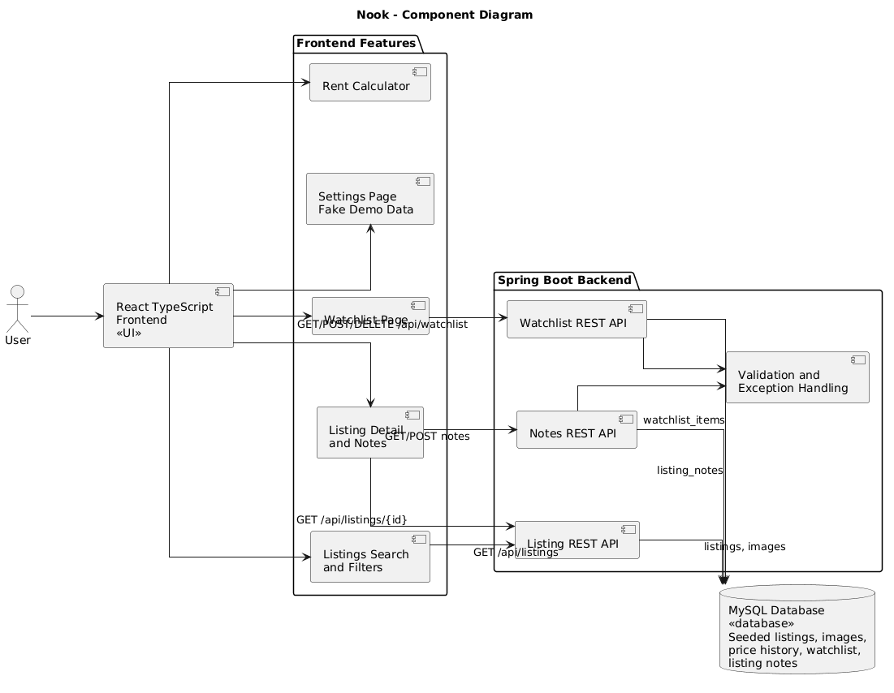
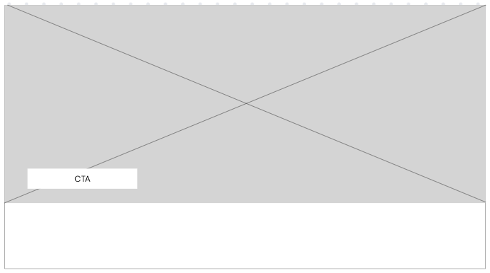
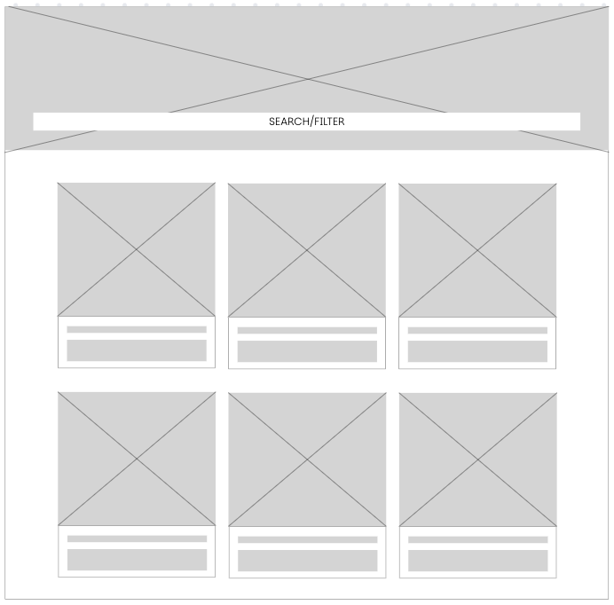
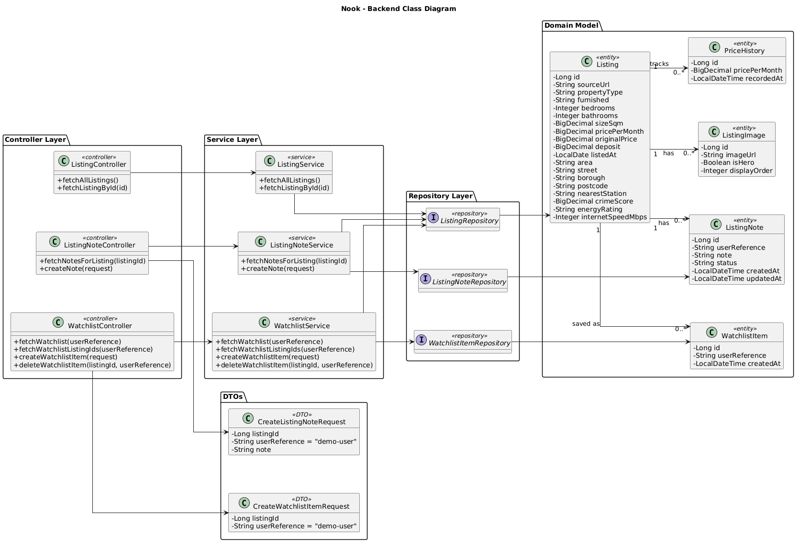
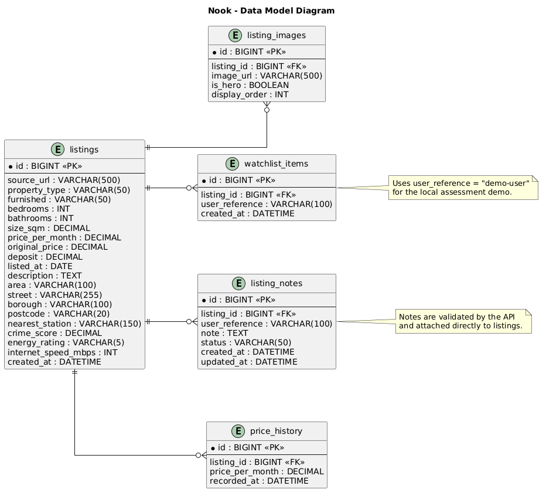
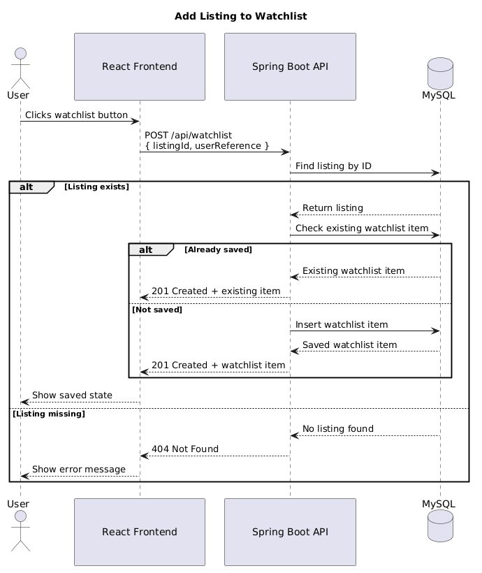
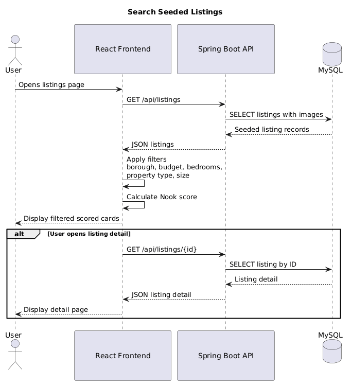

## Table of Contents

- [1. Introduction](#1-introduction)
  - [1.1 Document Purpose](#11-document-purpose)
  - [1.2 System Goals](#12-system-goals)
  - [1.3 Intended Audience](#13-intended-audience)
  - [1.4 Definitions and Acronyms](#14-definitions-and-acronyms)

- [2. System Overview](#2-system-overview)
  - [2.1 Product Summary](#21-product-summary)
  - [2.2 Business Problem](#22-business-problem)
  - [2.3 Project Scope](#23-project-scope)
  - [2.4 Assumptions](#24-assumptions)
  - [2.5 Constraints](#25-constraints)

- [3. Functional Requirements](#3-functional-requirements)
  - [3.1 Rental Listings](#31-rental-listings)
  - [3.2 Price Tracking](#32-price-tracking)
  - [3.3 Watchlist](#33-watchlist)
  - [3.4 Filtering and Search](#34-filtering-and-search)
  - [3.5 Notes](#35-notes)
  - [3.6 Settings and Preferences](#36-settings-and-preferences)
  - [3.7 Rent Calculator](#37-rent-calculator)

- [4. Non-Functional Requirements](#4-non-functional-requirements)
  - [4.1 Performance](#41-performance)
  - [4.2 Reliability](#42-reliability)
  - [4.3 Maintainability](#43-maintainability)
  - [4.4 Scalability](#44-scalability)
  - [4.5 Usability](#45-usability)
  - [4.6 Security](#46-security)
  - [4.7 Portability](#47-portability)

- [5. System Architecture](#5-system-architecture)
  - [5.1 Frontend](#51-frontend)
  - [5.2 Backend API](#52-backend-api)
  - [5.3 User Context](#53-user-context)
  - [5.4 Listing Data Source](#54-listing-data-source)
  - [5.5 Scoring Calculator](#55-scoring-calculator)

## 1. Introduction

Nook is a rental price tracking platform designed to make housing market changes easier to understand. The application helps users identify listings that may offer better value by comparing price, property features, neighbourhood context and affordability signals in one place.

Each listing is given a Nook score based on price drop, estimated crime score, internet speed, energy rating and property size. This allows users to move beyond simply browsing listings and instead compare properties using clearer, data-led signals.

**TLDR:** The goal of Nook is to help renters spot homes that are becoming better deals before they disappear.

### 1.1 Document Purpose

This Software Design Document outlines the design and structure of the Nook application, including its system purpose, implemented core features, and technical architecture. It is intended for developers, architects, maintainers and future contributors who need to understand how the application is designed, built and extended across its lifecycle.

### 1.2 System Goals

The main goals of Nook are to:
- Provide a central place for tracking rental listings
- Make rent changes visible and easy to understand
- Help users compare listings and areas
- Support a local assessment demo with seeded data, Docker, API documentation and persistent user actions

### 1.3 Intended Audience

This document is intended for:

- Developers building the frontend, backend and database layers
- Architects reviewing system structure and technical decisions
- Maintainers extending or debugging the application
- Future contributors onboarding to the codebase

### 1.4 Definitions and Acronyms

| Term | Definition |
|---|---|
| SDD | Software Design Document |
| API | Application Programming Interface |
| REST | Representational State Transfer |
| DTO | Data Transfer Object |
| CRUD | Create, Read, Update, Delete |
| MVP | Minimum Viable Product |
| UI | User Interface |
| UX | User Experience |
| ORM | Object-Relational Mapping |
| JPA | Java Persistence API |

---

## 2. System Overview

### 2.1 Product Summary

Nook is a rental market tracking platform that helps users monitor saved listings and make better-informed renting decisions. It combines listing browsing, filtering, scoring, watchlist management, personal notes, a fake demo profile, preferences and a rent affordability calculator.

### 2.2 Business Problem

Renters often struggle to compare listings accurately because price changes, personal notes, agent messages and property details are spread across different tabs, screenshots and websites. This makes it difficult to know whether a listing is genuinely good value or simply presented well.

Nook addresses this problem by allowing users to browse seeded listings, compare scored results, save properties to a watchlist and keep personal notes against individual listings.

### 2.3 Project Scope

The initial version of Nook focuses on the core rental listing workflow. The system allows users to:

- Search and filter rental listings by neighbourhood, budget, bedrooms and property type
- Score listings using price drop, estimated crime score, internet speed, energy rating and property size
- Save and remove listings from a database-backed watchlist using a demo user reference
- Add validated notes to listings and view existing notes in the same text area
- View a settings page with fake profile data and search preferences, including preferred borough
- Use a rent calculator to estimate required annual income or rent affordability

<!-- The following features are not required for the MVP, but could be added in future iterations:

- Filter listings by agent or listing URL 
- AI estate agent assistant to summarise listings and give broad renting advice
- Live crime data summaries for each area
- Local news or neighbourhood insight feeds
- Email or push alerts when a watched listing drops in price
- Map-based listing exploration
- Compare listings against average rent by borough or area
- Automated rental listing imports from external sources (TBD) -->

### 2.4 Assumptions

- The MVP focuses on search, scoring, saved listings, notes, settings and rent affordability.
- The application will be designed for local development and assessment demonstration using Docker Compose.
- Users will search seeded rental listings provided by the application database.
- Nook stores application-owned data in MySQL, including listings, listing images, price history, watchlist items and notes.
- Watchlist and notes use a fixed `demo-user` reference for the local demo instead of a full authentication provider.
- The scoring module calculates deal scores using seeded listing metrics such as current rent, original rent, estimated crime score, internet speed, energy rating and size.
- The settings page uses fake data to demonstrate profile and preference configuration without adding authentication scope.

### 2.5 Constraints

- The application must use **React** with **TypeScript** for the frontend.
- The backend must use **Java Spring Boot**.
- The database must use **MySQL**.
- The full stack must be containerised with **Docker**.
- The API must include clear documentation.
- The system should be realistic to build within the CBF/LME final assessment timeframe.

## 3. Functional Requirements

### 3.1 Rental Listings

The system shall allow users to:

- View listings
- View a single listing in detail
- Save listings to a watchlist

### 3.2 Price Tracking

The system shall allow users to:

- View current rent and original rent values
- Calculate price movement
- Display rent drop percentage

### 3.3 Watchlist

The system shall allow users to:

- Save listings to a personal watchlist
- Remove listings from the watchlist without deleting the underlying listing
- View saved listings on a dedicated watchlist page
- Persist watchlist items in MySQL rather than browser local storage

### 3.4 Filtering and Search

The system shall allow users to filter listings by:

- Personal budget
- Bedrooms
- Property type
- Area or borough
- Listing size

### 3.5 Notes

The system shall allow users to:

- Add personal notes to a listing
- View an existing note in the same textbox area
- Save notes with frontend validation for empty or overlong content
- Save notes with backend validation for required listing ID, required note content and maximum note length
- Show a note attached label in search results when a listing has an existing note

### 3.6 Settings and Preferences

The system shall allow users to:

- View a basic settings page using fake demo profile data
- View profile information used for local watchlist and notes features
- View preference information such as preferred borough, budget and bedroom count

### 3.7 Rent Calculator

The system shall allow users to:

- Estimate required annual income from monthly rent
- Estimate affordable monthly rent from annual income
- Estimate guarantor income requirements

## 4. Non-Functional Requirements

### 4.1 Performance

The system should return listing and dashboard data within an acceptable response time for local development and demo usage.

### 4.2 Reliability

The system should handle invalid user input and backend errors without crashing the application.

### 4.3 Maintainability

The codebase should use clear separation of concerns across frontend components, backend controllers, services, repositories and entities.

### 4.4 Scalability

The system should be designed so that future versions can support authentication, external APIs, automated imports, larger datasets and richer preference handling.

### 4.5 Usability

The user interface should be clear, responsive and easy to navigate.

### 4.6 Security

The system should avoid hardcoded secrets and use environment variables for database credentials and external API keys. User-entered note data is validated on both the frontend and backend. Database credentials are supplied through `.env` for Docker or `local.properties` for local development.

### 4.7 Portability

The application should be able to run locally through Docker Compose.

---

## 5. System Architecture

Nook follows a three-tier architecture made up of a React frontend, a Spring Boot backend API and a MySQL database. Listing data is seeded into MySQL for the local assessment demo.

| Layer | Responsibility |
|---|---|
| Frontend (React, TypeScript) | Displays the user interface, fetches listings, shows scored listings, manages filters, and allows users to save listings or update notes. |
| Backend API (Java Spring Boot) | Handles REST requests, listing retrieval, watchlist operations, note creation, validation and error handling. |
| Database (MySQL) | Stores seeded listings, listing images, price history, watchlist items and listing notes. |

### 5.1 Frontend

The frontend is built with React and TypeScript, with Tailwind styling. It communicates with the backend using HTTP requests and receives JSON responses.

The frontend includes pages and components for:

- Home page
- Listing filtering
- Scored search results
- Watchlist
- Listing detail view
- Notes
- Settings and preferences
- Rent calculator

These wireframes show the intended shape of the main user-facing screens.

The home view provides the main landing experience and entry point into search.

The search results view focuses on filtering listings.

The listing detail view shows more information about a property, and user actions such as saving or adding notes.

### 5.2 Backend API

The backend is built with Java Spring Boot and exposes RESTful endpoints for the frontend. It manages communication between the frontend and the MySQL database.

The backend is responsible for:

- Returning seeded listings and individual listing details
- Returning watchlist items and watchlist listing IDs
- Creating and deleting watchlist items
- Returning listing notes and creating validated notes
- Handling validation and system errors through a central exception handler

The backend structure is summarised below.

This combined backend class diagram shows the main services, DTOs, domain entities and repositories involved in listing search, scoring and saved-listing management.

This diagram shows the normalized persistence model used for listings, listing images, saved listings, notes and price history.

### 5.3 User Context

The implemented MVP does not include login or registration. User-specific features use a fixed `demo-user` reference so the assessment can demonstrate persistent watchlist and notes behaviour without adding authentication scope.

User-owned demo features include:

- Saving a listing to the watchlist
- Removing a listing from the watchlist
- Adding and viewing notes

This design keeps the data model close to a real authenticated system because watchlist items and notes are still linked to a user reference. A future authentication layer could replace `demo-user` with a real user ID from an identity provider without changing the core feature flow.

The local demo flow is designed as follows:

- The frontend displays actions such as the watchlist button and notes form
- The frontend sends the selected listing ID and `demo-user` reference to the backend
- The backend validates request data and checks that the listing exists
- The backend persists the watchlist item or note in MySQL

This sequence shows the broader saved-listing flow and can be extended with authentication in a future version.

### 5.4 Listing Data Source

The MVP uses seeded London rental listings stored in MySQL. The seed data lives in `api/src/main/resources/data.sql`, and the schema lives in `api/src/main/resources/schema.sql`. Spring Boot runs the SQL scripts on startup so the assessment environment has consistent demo data.

The backend exposes listing endpoints from this seeded data, and the frontend applies search filters such as borough, budget, bedrooms, property type and size. This avoids relying on external API access during assessment while still demonstrating a realistic full-stack data flow.

Future versions could replace or supplement the seed data with a live listing import service, but this is outside the current MVP scope.

This sequence shows the intended search flow. In the implemented MVP, the backend returns seeded listings from MySQL and the frontend filters and ranks them for the user.

### 5.5 Scoring Calculator

The scoring module calculates how strong a rental deal appears to be. It uses seeded listing information such as current rent, original rent, estimated crime score, internet speed, energy rating and property size.
